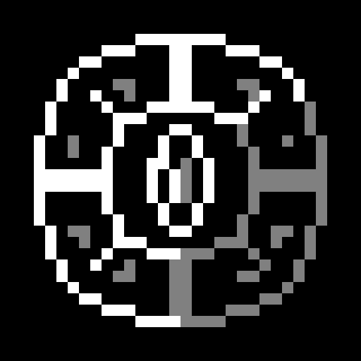

<p align="center">
  
</p>

# Tetra Apothic Link

Tetra Apothic Link is a Minecraft 1.20.1 Forge addon that connects Tetra and Tetrawear equipment with Apotheosis loot categories, affixes, gems, reforging, and high-level enchantment progression.

The addon keeps Tetra's modular structure authoritative. Apotheosis effects are resolved against the actual tool or armor context, while magic capacity and structural integrity remain separate budgets.

## Features

- Classifies Tetrawear armor as light or heavy from its resolved structural weight.
- Adds light/heavy armor loot categories, affix rules, gem rules, and armor-specific effects.
- Makes modular Tetra tools and ranged weapons participate in appropriate Apotheosis categories.
- Adds four Arcane Capacity Inscription tiers without replacing or extending Tetra's original Gild improvement.
- Adds a staged scroll progression using Apotheosis infusion setups from the Overworld through the End.
- Scales Tetrawear's temporary energy attack bonus against high armor values.
- Provides data-driven applicability, armor-weight, tool-category, gem-patch, and special-effect rules.
- Optionally integrates with Create: Enchantment Industry for scroll printing and explicit overload handling.

## Ascension Table (experimental)

The Ascension Table uses Apotheosis' own enchanting screen, bookshelf statistics, option costs, Quanta/rectification and Arcana selection algorithms. It shows the existing three stat bars, without a new rectification control. Place shelves around it exactly as for an Apotheosis enchanting table; put one assembled Tetra item in the left slot and 1/2/3 media in the right slot for the selected option. Closing the screen returns both inputs; the block has no persistent inventory.

- **Structural Medium:** permanent equipment-owned integrity tier, up to VIII. Supply becomes `floor(original_supply * (1 + tier * .25)) + tier * 2`; usage is unchanged.
- **Material Medium / Attenuating Medium:** independently amplify or attenuate primary, secondary and tertiary material contributions. Arcana affects the number and rarity weighting of selected channels. Existing opposite-direction tuning is never silently overwritten. These are source-material multipliers, not global damage multipliers; negative coefficients keep their sign.
- **Overdrive Medium (handheld equipment only):** a cheap unstable integrity tier and permission to install structures up to 60 integrity over budget. Native Tetra Winded, Vexing and Infested improvements are projected once onto the whole item, not onto removable modules.
- **Stabilizing Medium:** high-cost processing converts unstable integrity into stable integrity up to the rolled tier. Whole-item destabilization is cleared only once the unstable tier is resolved and the structure fits; Tetra's normal Cleanse can also clear resolved whole-item destabilization.

Ascension is stored outside modules and `affix_data`, survives supported replacements and reforging, and never transfers to salvaged components. Repeated processing keeps the stronger tier rather than stacking infinitely. The internal selection descriptors are not actual enchantments on the equipment and are excluded from loot and trades. Apotheosis' enchantment module must be enabled. Models currently reuse vanilla textures.

## Arcane Capacity progression

| Tier | Capacity | Integrity | Scroll stage | Workbench material |
| --- | ---: | ---: | --- | --- |
| I | +60 | 0 | Overworld infusion | Gem Dust + Uncommon Material |
| II | +120 | -1 | Nether Quanta or Ocean Arcana infusion | Gem Dust + Rare Material |
| III | +200 | -1 | Deep Dark balanced infusion | Gem Dust + Epic Material |
| IV | +300 | -2 | End draconic infusion | Gem Dust + Mythic Material |

Tier I requires Tetra's existing Gild V improvement. Each later tier upgrades the previous inscription rather than stacking a separate capacity modifier.

## Requirements

| Mod | Supported range |
| --- | --- |
| Minecraft | 1.20.1 |
| Forge | 47.4.16 to below 48 |
| Tetra | 6.17.x |
| Apotheosis | 7.4.8 to below 7.5.0 |
| Placebo | 8.6.3 to below 9.0.0 |
| Apothic Attributes / AttributesLib | 1.3.7 to below 2.0.0 |

Optional integrations:

- Tetrawear 1.0.x — enables modular armor classification, armor/energy effects, and energy balancing. It is not required for Tetra tools, ranged weapons, affixes/gems/reforging, or Arcane Capacity progression.
- Tetracelium 1.3.x
- Create: Enchantment Industry 2.5.x
- Tetra Insight 0.1.6 or newer is recommended on the client for detailed Holosphere browsing.

Jade and JEI are used in the development runtime, but are not required by this addon.

## Installation

Install the required mods and place the release JAR in the `mods` folder on both the client and server. Keep the same addon version and datapack rules on both sides.

Server settings are written to `tetra_apothic_link-server.toml`. Most compatibility rules can also be overridden with datapacks under the `tetra_apothic_link` reload-listener directories shipped in the JAR.

## Building

Java 17 is required.

```text
./gradlew clean test build
```

For a development runtime without Tetrawear, use `./gradlew -PwithoutTetrawear=true runClient` (or `runServer`). This flag removes only the development runtime dependency; published installations can simply omit Tetrawear. Remove any manually installed Tetrawear JAR from the development mods folder as well.

The release JAR is generated under `build/libs/`. Do not distribute the `-sources.jar` as the playable mod.

## 中文简介

Tetra Apothic Link 为 Tetra、Tetrawear 与神化建立完整联动：根据模块结构识别工具与轻重甲类别，让神化词缀、宝石与重铸正确作用于模块化装备，并提供四档“魔力刻印”成长线。

Tetrawear 为可选联动：不安装它时仍可使用 Tetra 工具、弓弩与神化的词缀、宝石、重铸及魔力刻印成长线；安装后额外启用模块护甲的轻重分类与精力相关效果。若整合包与 Tetrawear 不兼容，可直接不安装它。

魔力刻印不会覆盖或继续提升原版镀金等级。卷轴依次使用主世界、下界或海洋、深暗之域、末地阶段的神化灌注条件解锁；工作台安装则消耗宝石粉和对应等级的重铸材料。

## License

Code and original project artwork are available under the [MIT License](LICENSE).
